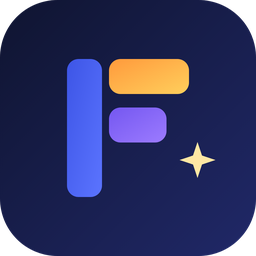

<p align="center"></p>

# Full Stack Founder

### A team of specialists, taking every idea from your mind to your customer's hands.

**Your one-person product agency, inside Claude Code.**

You can build it. Full Stack Founder runs the other half of a startup: research, pricing, design, marketing and selling, all from one command. Each job goes to the specialist skill builders already trust, and it adds only about 700 tokens to a session.

```
/plugin marketplace add https://github.com/HassanRaza1313/full-stack-founder.git
/plugin install founder@full-stack-founder
/founder:ceo is my meal-planner idea worth building?
```

## Your journey

1. **Try it:** ask `/founder:ceo` about one idea. No setup needed.
2. **Set up once:** `/founder:setup` installs only what your next stage needs.
3. **Say where an idea should go.** It runs the journey and stops for your decisions.

| You say | It runs |
|---|---|
| "Find me ideas in fintech" | A hunt through real complaints, reviews and competitor gaps |
| "Is this worth building?" | A short interview to pin down your idea, then research, pricing, the numbers and a board vote |
| "Build it" | Repo, spec, design, build and tests |
| "Launch it" | Case study, demo, posts and outreach, as drafts you send |
| "Add dark mode to Fraud Guard" | Review, spec, build and release |
| `/founder:adopt you/my-app` or a folder | Brings in code you already have (a GitHub repo, or a vibe-coded folder) and gets it ready to build on |

4. **Run your portfolio:** `/founder:ceo` on its own gives one brief across every product.
5. **Stop when you stop:** `/founder:pause` shuts everything down. `/founder:resume` brings back only what's needed.

## Built for what actually goes wrong

**"I can build it. Selling it is the problem."**
- Every department behind one command: research, pricing, design, build, marketing, sales, support, legal.
- A board for the big calls.
- 12 journeys, from "is this worth it?" to your first paying customer.

**"Five half-built projects, and no idea where each stands."**
- One brief: each product's stage, key number and next step.
- The decisions waiting on you, each with a recommendation.

**"All-in-one tools are average at everything."**
- Each job goes to the best-known specialist for it:
  - **Build:** Matt Pocock
  - **Design:** Impeccable, Meng To
  - **Research, marketing, sales:** Corey Haines
  - **Board and numbers:** founder-skill
  - **Legal and support:** Anthropic
- 52 skills, 650,000+ GitHub stars between them.

**"Skills eat my context and my usage limit."**
- Research is gathered once by a cheaper model, then judged from the notes. Measured on the same ideas:
  - a quick read went from about **4.5M to 0.7M** tokens;
  - a hunt went from about **4M to 1.2M**.
- You see the cost before every journey, and where you can stop.
- Skills load only when a job needs them: about 700 tokens added to a session, against 3,400 for the same 52 skills installed the usual way.

**"Installs break, and updates break them again."**
- Setup installs only the basics.
- Each release ships the exact skill versions it was tested with.
- Upstream changes reach you only after they pass our tests.

**"It asks me everything, or does things I never approved."**
- It works on its own between your decisions.
- Posts, emails and outreach arrive as drafts. You send them.

**"AI tells me every idea is brilliant."**
- Every verdict opens with the case against the idea, with sources.
- A deliberately weak idea scored 11/40, then got three sharper versions.

**"I researched this once. Where did it go?"**
- Every result is a dated file, with sources.
- `/founder:ask` answers from them, and flags what's out of date.

**"I'm paying for servers before I have a customer."**
- Case studies, demos and posts on free hosting.
- Paid infrastructure only once real customers ask.

**"Docker is eating my RAM again."**
- `/founder:pause` saves your work and stops Docker, WSL and every service. In testing it freed 1.9 GB.
- `/founder:resume` starts only what the next task needs.

## Install

You need Claude Code with a Pro or Max plan.

**In a terminal** (PowerShell, Terminal or bash). This installs for your user, so every project gets it:

```
claude plugin marketplace add https://github.com/HassanRaza1313/full-stack-founder.git
claude plugin install founder@full-stack-founder
claude plugin list
```

**Or in a Claude Code chat:**

```
/plugin marketplace add https://github.com/HassanRaza1313/full-stack-founder.git
/plugin install founder@full-stack-founder
```

Then **start a new Claude Code session**, and type `/founder` to see the commands. Install stuck? See [If something breaks](GUIDE.md#8-if-something-breaks).

## Set up

Try `/founder:ceo` on one idea first. It needs no setup. When you're ready:

```
/founder:setup
```

- **It checks your machine** and lists what's ready, what it installs, and what needs you.
- **Claude installs** the tools (Git, Node, the GitHub CLI and more) in one batch you approve.
- **You do** only the sign-ins and accounts, one step at a time. No passwords in chat.
- **You choose:**
  - your folders
  - a free `.vercel.app` site, or your own domain (about $10 a year)
  - a local media folder, or Google Drive
- **Set up in stages:** ideas, then build, then showcase, each only when you need it.

**[The guide](GUIDE.md)** walks through every step, from setup to your first launch.

## The commands

Start with these. Everything else runs behind them.

| | |
|---|---|
| `/founder:ceo` | The front door. A portfolio brief, or any request in plain words |
| `/founder:hunt` | Find product ideas from real complaints, reviews and competitor gaps |
| `/founder:board` | Your board of directors for any decision |
| `/founder:ask` | Answers from everything already researched and decided |
| `/founder:setup` | Get this machine ready for the next stage |
| `/founder:pause` · `/founder:resume` | Stop everything; start only what's needed |

<details>
<summary>Every command, for direct control</summary>

| | |
|---|---|
| `/founder:run <playbook>` | A whole journey: validate, idea-to-launch, feature, customer-test, finance-check, first-customers, showcase, health, weekly, monthly-review, raise, graduate |
| `/founder:idea` · `/founder:portfolio` · `/founder:next` | Capture ideas and enhancements; the detailed portfolio view; "what should I do now?" on one product |
| `/founder:research` · `/founder:finance` · `/founder:discover` · `/founder:market` · `/founder:sales` · `/founder:listen` · `/founder:support` · `/founder:legal` | The departments, each runnable on its own |
| `/founder:adopt` | Bring in code you already have, from GitHub or a folder: your ideas first, a brief, a plan, your ideas reviewed, installed and tested, one home for every copy |
| `/founder:setup-product` · `/founder:spec` · `/founder:design` · `/founder:build` · `/founder:verify` · `/founder:release` · `/founder:showcase` | Engineering, built on Matt Pocock's skills and Impeccable, and the showcase |

</details>

Run `/founder:portfolio help` for one line per command, or ask `/founder:ceo` in plain words.

## What it doesn't do

- **Act in public for you.** You send every post and message. Nothing is published, deployed or paid for without your yes.
- **Replace a lawyer, an accountant or real customers.** Legal output is "not legal advice". Simulated customers never count as evidence.
- **Scrape or sign in anywhere.** Blocked sites are read through your own browser, read-only.
- **Make big jobs free.** Most single steps take 0.2–2M tokens (mostly cached re-reads), and a full validation a few million. You see the estimate first, measured per flow in [costs.md](plugin/references/costs.md).
- **Run on a server.** It runs in your Claude Code, with your files and your GitHub.
- **Speak for the skills' authors.** It ships their open-source skills with credit and licences. They haven't endorsed it.
- **Run paid production yet.** Hosting, billing and monitoring for paying customers come in a later release.

## Tested

- **Tested end to end on Windows.**
- **Built for macOS and Linux too.** Automated install checks pass on both on every change. Full end-to-end testing there is still to come.
- **Automated tests** run every script end to end against a stand-in GitHub, and check every flow's references and plain-language rules, on Windows, macOS and Linux on every change ([`plugin/tests/`](plugin/tests/)).
- **Evals** check the first run, routing, honest verdicts, pinned skills and plain-language onboarding ([`plugin/evals/`](plugin/evals/)).
- **Smoke runs** drive every flow headless in a sandbox before each release (`plugin/tests/smoke.mjs`).

## Credits

- Built on open-source skills by Matt Pocock, Corey Haines, ferdinandobons, Paul Bakaus (Impeccable), Cloudflare, GreenSock, HeyGen, Meng To, Anthropic and others.
- Pinned, unchanged copies ship with their original licences in [`plugin/vendor/`](plugin/vendor/). See [CREDITS.md](CREDITS.md).
- Want a skill outside Full Stack Founder? Install the original from its author.

## License

MIT © 2026 Hassan Raza Mahmood
